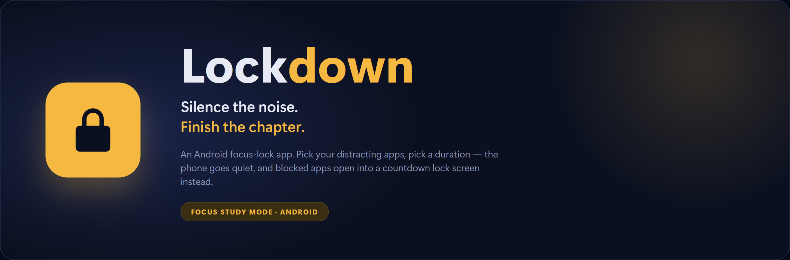
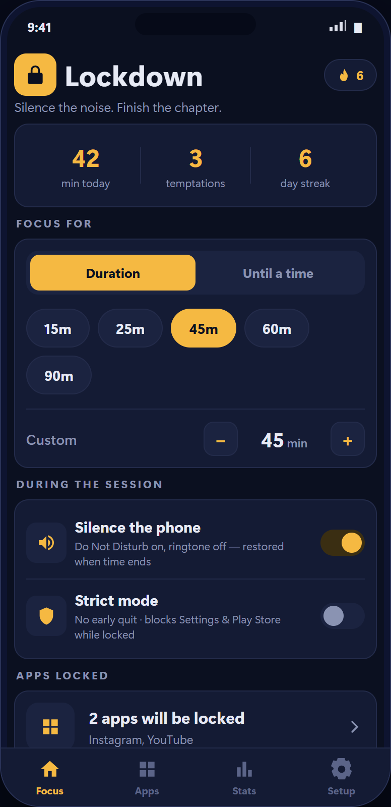
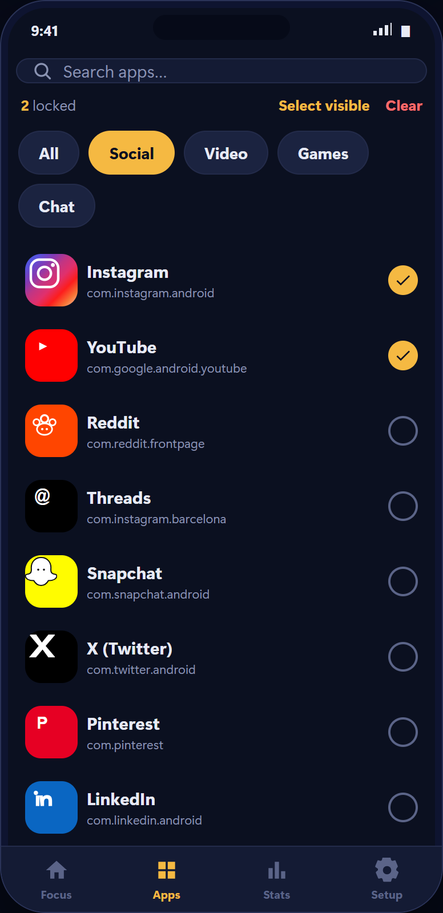
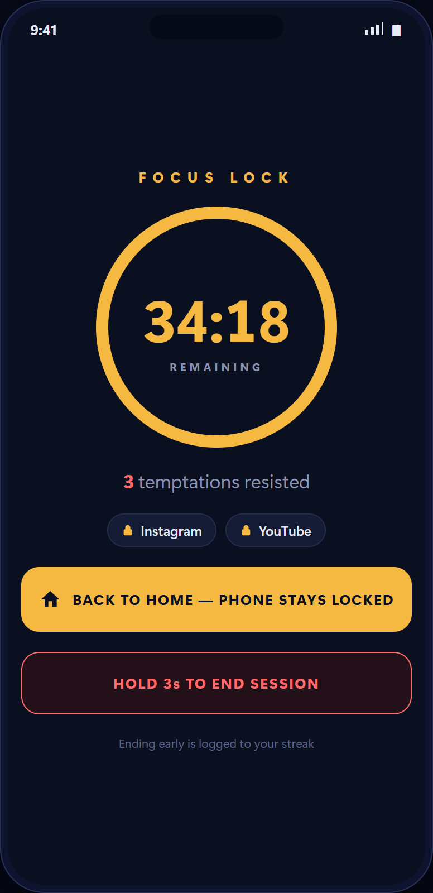
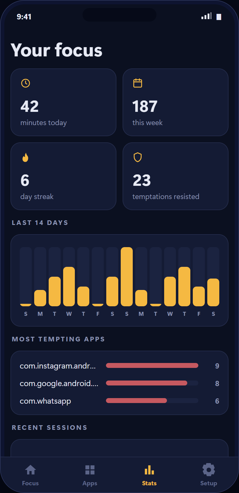
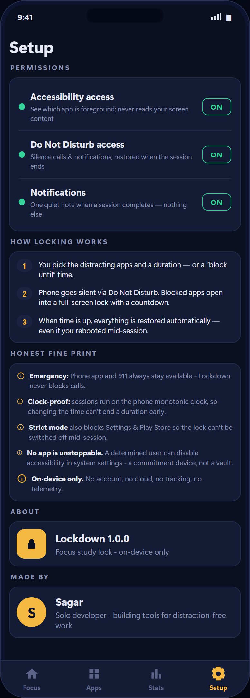

<p align="center">
  
</p>

<p align="center">
  <b>Lockdown</b> locks your most distracting apps behind a countdown and keeps the phone silent until a study session ends.<br/>
  It locks <i>your chosen apps</i> — never the internet, never the whole phone.
</p>

<p align="center">
  
  
  
  
  
</p>

---

> ✅ **Recommended install:** use the APK from **GitHub Releases** (linked in [Installation](#installation)). The older EAS-built sideloaded APK from build `0850cdb2` is broken (R8 stripped the native module) — do not use it. Release builds from `master` include the fix committed in `ee6b612` (`plugins/withLockdownKeepRules.js`). Debug builds (`expo run:android`) are unaffected either way.

## Why Lockdown exists

Willpower loses to dopamine. Lockdown doesn't fight your willpower with willpower — it makes the distraction *physically unreachable* while you study, and restores everything automatically when time's up.

- Pick the apps that steal your focus (social, video, games — your blocklist, not a guess).
- Pick a duration — or a "block until" clock time.
- Phone goes silent (true Do Not Disturb). Blocked apps open into a full-screen countdown lock instead.
- When time expires, DND and ringer state restore **by themselves** — even after a reboot.

<p align="center">
  
  
  
  
  
</p>

## Features

- **App-specific locking** — your blocklist only. Never "the whole internet", never everything.
- **Silent sessions** — real Do Not Disturb (calls silenced too); your previous ringer state is restored automatically on end.
- **Countdown lock screen** — opening a blocked app shows time remaining and how many times you've reached for it ("temptations resisted").
- **Two timer modes** — "Focus for 45m" (clock-change-proof, anchored to `elapsedRealtime()`) or "Block until 9:30 PM".
- **Timetable auto-lock** — weekly study blocks (days + start/end times) start a session by themselves, with your blocklist, silence and strict settings. No app open, no willpower.
- **Strict mode** — no early quit except a 10-second emergency hold; also blocks **Settings, Play Store and the package installer** so you can't flip the switch mid-session.
- **Survives reboot** — session state lives in native `SharedPreferences`; a reboot re-arms DND and the end alarm via `BootReceiver`.
- **Temptation tracking** — every blocked-app open attempt is counted; 14-day chart, day streak, per-app leaderboard in Stats.
- **Honest emergency path** — dialer/phone is never blocked; ending early is always possible (hold 3s in Normal mode, 10s in Strict), and it's logged as "quit early" / "emergency" in your stats.
- **On-device only** — no account, no cloud, no analytics, no network calls. Stats live in AsyncStorage; sessions live in native prefs.

## How it works

<p align="center">
  
</p>

React Native (Expo SDK 58) UI + a small native Kotlin core in `modules/lockdown/` — deliberately minimal, no third-party blocker libraries:

```
JS / React Native
  Focus · Timetable · Apps · Stats · Setup · Session takeover
        |                              |
        | requireNativeModule          | AsyncStorage
  LockdownModule.kt                    stats + blocked list + timetable
        |
  SessionStore / TimetableStore (SharedPreferences)
        |
  UsageMonitorService (foreground service)
    UsageStats polling -> overlay lock screen
    SessionEndReceiver -> restore DND + notify
    TimetableReceiver -> auto-start session at block start
    BootReceiver -> re-arm DND, end alarm + timetable alarms
```

- `UsageMonitorService` runs as a foreground service while a session is active and polls `UsageStatsManager` every ~800ms. If the foreground app is on your blocklist, a full-screen overlay swallows every touch so it is unusable until time is up — the same mechanism Digital Wellbeing uses. No Accessibility permission, so Play Protect does not flag installs.
- The overlay is a pure-Android full-screen window — it survives the JS bundle being killed and shows a live countdown.
- `SessionStore` anchors the session to `SystemClock.elapsedRealtime()`, so changing the phone clock can't shorten a duration; a reboot re-anchors from the wall-clock end and re-applies everything.
- Stats (minutes focused, temptations, per-app counts) are stored in AsyncStorage; the session itself is authoritative native-side, so stats never lie.

Strict mode additionally adds `com.android.settings`, `com.android.vending` and the package installer to the blocklist for the session, closing the obvious "turn off the permission" escape hatch.

### Timetable auto-lock

The **Timetable** tab holds your weekly study blocks. Each block is a label, a set of weekdays, a start time and an end time. When a block's start time arrives, `TimetableReceiver` starts a normal session that ends at the block's end time — using your current blocklist plus the silence/strict toggles from that tab.

- Alarms are `AlarmManager.setAlarmClock()` calls, so they fire in Doze and are allowed to start the foreground monitor from the background. They fall back to `setExactAndAllowWhileIdle()` if exact-alarm permission is missing.
- Deleting a block cancels its pending alarm; the app re-arms on boot, on clock/timezone changes, and whenever it comes to the foreground.
- An end time earlier than the start time (e.g. 10 PM → 1 AM) is treated as the next day.
- If a block starts while another session is live, the old session is replaced (not stacked). If the blocklist is empty, the block is skipped and the schedule stays armed.

## Permissions

| Permission | Why it's needed | If you deny it |
|---|---|---|
| **Usage access** (OPSTR_GET_USAGE_STATS) | Detect which app is in the foreground | Blocking is disabled entirely |
| **Display over other apps** (SYSTEM_ALERT_WINDOW) | Show the full-screen lock over the blocked app | Blocking is disabled entirely |
| **Notification Policy access** (DND) | Silence calls/notifications; restore your previous ringer state | Phone won't be silenced |
| **Receive boot completed** | Re-arm the session after a reboot | Session silently ends on reboot |
| **Use exact alarm** | Fire the session-end alarm exactly on time, even in Doze | End may be delayed by OEM battery savers |
| **Post notifications** | One "session complete" note | You just won't get that note |
| Launcher visibility (`QUERY_ALL_PACKAGES`-style) | List your launchable apps to choose what to lock | Apps tab shows nothing |

## Screens & tabs

| Tab | What it does |
|---|---|
| **Focus** | Preset durations (15/25/45/60/90m) or custom, or "Until a time" mode, silence/strict toggles, streak badge, one-tap **START LOCKDOWN** |
| **Timetable** | Weekly study blocks (days + start/end), master auto-lock switch, per-block enable/edit/delete, "next auto-lock" preview, auto-session silence/strict settings |
| **Apps** | Search, category filters (Social / Video / Games / Chat), select/clear, real app icons from the OS |
| **Stats** | Minutes today / week, day streak, 14-day chart, temptation leaderboard, recent sessions with completion status |
| **Setup** | Permission grants, blocking diagnostics, how locking works, honest fine print |

## Installation

The app is distributed as an installable APK via **GitHub Releases** (sideloaded, not Play Store):

1. Go to the Releases page: https://github.com/Sagar0810k/lockdown/releases
2. Download **`Lockdown-1.0.0.apk`** from the latest release (rolling release, built automatically from the latest `master` by GitHub Actions). Or from a PC:
   ```sh
   curl -L -o Lockdown-1.0.0.apk https://github.com/Sagar0810k/lockdown/releases/download/v1.0.0/Lockdown-1.0.0.apk
   adb install Lockdown-1.0.0.apk
   ```
3. Open the app → **Setup** tab → grant the permissions (Usage access, Display over other apps, Do Not Disturb) → pick apps in **Apps** → **START LOCKDOWN**.
4. On Realme/Oppo/Vivo/Xiaomi, explicitly allow Lockdown to run in the background: set Battery to **Unrestricted** (or “Don’t optimize”) and enable **Auto-launch / background activity**. These phones can suspend the monitor even when Android permissions are granted.
5. If blocking still fails, on **Setup → Blocking diagnostics** tap **CHECK AGAIN** after opening a locked app. The screen shows whether the monitor is running, which foreground package it detected, and whether Android refused the overlay.

First launch takes ~2 minutes. Everything is on-device — you don't sign in to anything.

## Build & distribution

```sh
npm ci
npx expo prebuild --no-install          # generate android/ from CNG
npx eas build -p android --profile preview   # produces the installable APK
```

**GitHub Releases:** every push to `master` triggers the [Build APK](https://github.com/Sagar0810k/lockdown/actions/workflows/build-apk.yml) workflow, which builds the APK and publishes it automatically to the rolling release:

- Releases: https://github.com/Sagar0810k/lockdown/releases
- Direct asset: https://github.com/Sagar0810k/lockdown/releases/download/v1.0.0/Lockdown-1.0.0.apk

Project links:

- EAS project: https://expo.dev/accounts/sagar0810k/projects/lockdown
- Builds page: https://expo.dev/accounts/sagar0810k/projects/lockdown/builds

> **Free plan note:** 15 Android builds per month. Debug APKs (`npx expo run:android`) are unlimited and not affected by the release minification issue.

**Continuous Native Generation:** `android/` is gitignored and regenerated by prebuild — all native code lives in `modules/lockdown/`. Never edit `android/` by hand. The `plugins/` directory holds config plugins (`./plugins/withLightApk.js` — arm64-only ABI filter, `./plugins/withLockdownKeepRules.js` — R8 keep rules for the reflection-loaded registry).

## Repository layout

```
lockdown/
├── App.js                 # root tab navigation + takeover while a session is active
├── index.js               # Expo entry
├── app.json               # Expo config (package, icons, permissions)
├── eas.json               # preview = APK, production = app-bundle
├── assets/                # icon, adaptive icon, splash, favicon (hand-drawn SVG → GDI+)
├── docs/                  # this README's images (mockups regenerated from RN sources)
├── modules/lockdown/      # native Kotlin module + usage monitor service + overlay
├── plugins/               # Expo config plugins (ABI filter, R8 keep rules)
└── src/
    ├── native.js, storage.js, timetable.js, theme.js, components.js
    └── screens/           # Home, Timetable, Apps, Session, Stats, Settings
```

## Edge cases & decisions

| Edge case | Decision |
|---|---|
| User changes system clock | Duration sessions anchor to `elapsedRealtime()` — unaffected. Wall-clock "until" sessions follow the wall clock by design. Timetable alarms re-arm on clock/timezone changes |
    │ BootReceiver → re-arm DND, end alarm + timetable alarms                │
| Timetable block starts while another session is live | The old session is replaced (never stacked); a block with an empty blocklist is skipped and stays armed |
| Timetable block ends after midnight | End time earlier than the start rolls to the next day |
| App force-stopped / swiped from recents | Enforcement lives in a foreground service, not in the app — killing the UI does not stop blocking |
| Emergency call during focus | Dialer is never on the blocklist — by design |
| Escape attempt (Settings/Play Store/uninstall) | Blocked in Strict mode; soft-logged as temptation in other modes |
| Clock-change bypass | Inherent to wall-clock "until" sessions; duration sessions can't be shortened |
| Disabled usage access / overlay | App detects it on resume and nags you to re-enable (soft fail, not a fight) |

See `lockdown-thinking.md` for the full design rationale, threat model and what was deliberately cut.

## Honest limitations

- **Not tamper-proof.** A determined user can disable usage access or the overlay in system settings — no ordinary app can prevent that without Device Owner. Lockdown is a commitment device, not a vault.
- Some OEM battery savers (Xiaomi/Oppo/Vivo/Realme aggressive kill modes) may defer the exact end alarm or suspend the monitor; add Lockdown to the "unrestricted" / "never kill" battery and auto-launch whitelist. The session itself restores on next boot/unlock.
- Force-stopping the app from system settings freezes enforcement until it's restarted (the session itself re-arms on reboot).
- 14-day stats chart is a view, not a data export — no accounts, no sync, nothing leaves the phone.
- Backend bugs: the JS bridge fails soft — if the native module is missing (e.g. broken build), the UI renders and tells you plainly instead of crashing.

## Troubleshooting

| Symptom | Likely cause / fix |
|---|---|
| GRANT buttons do nothing / "build required" | You have the pre–`ee6b612` APK. It is missing its native module under R8 minification. Install the next build; see the warning at the top |
| App list is empty in Apps tab | Launcher visibility query not granted or the phone has no launchable apps besides system ones; also check that usage access is enabled |
| Session ends late | OEM battery saver; add Lockdown to your "never kill" / battery-usage whitelist |
| Auto-lock never starts | Timetable master switch off, no blocklist picked, or exact-alarm permission revoked; check the blocklist and Setup permissions |
| Auto-lock fires at the wrong time | System clock/timezone changed; open the app once so the alarms re-arm, or reboot |
| DND works but app opens | Monitor is not seeing or not drawing. Check **Setup → Blocking diagnostics** (`CHECK AGAIN` after opening the blocked app), then whitelist Lockdown from battery optimization/auto-launch restrictions |
| Phone rings during focus | DND access not granted, or the "Silence the phone" toggle is off |
| Can't install APK | Enable "Install unknown apps" for your browser/file manager; verify the APK SHA against the one printed on the EAS builds page |

## Contributing

Small, focused codebase by design. If you change anything in `modules/lockdown/`, run the real APK on a real device before proposing — unit tests cannot see the foreground-app detection path.

1. Fork → branch → `npm ci && npx expo prebuild`
2. Test on at least one physical device (Android 14/15)
3. Open a PR with before/after notes. Keep it light — every byte ships in the APK.

## License

MIT — see [LICENSE](LICENSE). Built with Expo SDK 58, React Native 0.88, Kotlin, and a suspicious amount of stubbornness.